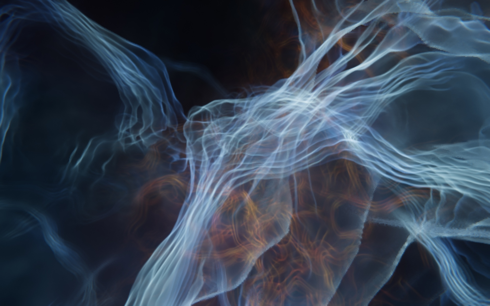

# Nebula

A macOS screensaver that flies endlessly through a glowing supernova remnant.



Each launch starts in empty space, flies out through the ragged edge of the nebula and then drifts through layered blue shock fronts, gold filigree and red hydrogen haze.  Every launch gets its own random route, so no two runs look the same.  With several displays only the main one (the one with the menu bar) shows the nebula; the others stay black.  It is raymarched on the GPU in Metal with a filmic HDR pipeline, and all of it is procedural - there are no images or videos involved.

## Vibe coded

This project is vibe coded.  All of the code was written by Claude Code.  I steered it with reference images, feedback on how the output looked and power measurements, and made the design calls, but I haven't reviewed the code.  It works on my machine, but treat it accordingly.

## Requirements

macOS 14 or later on Apple silicon.  It is tuned for HiDPI displays.

## Installing

Download the latest `nebula-v<version>.zip` from the [Releases](../../releases) page and unzip it.  Double-click `Nebula.saver` and macOS will offer to install it, then choose Nebula in System Settings under Screen Saver.  To update, install a newer release over the top.

## Building from source

Building needs the Xcode command line tools (`xcode-select --install`).

```sh
make install
```

This builds `Nebula.saver` and copies it to `~/Library/Screen Savers`.  `make run` opens a test window instead, which is handy for trying it without waiting for the screensaver to start.

## Power profiling

Run `make profile` from Terminal.  It asks for `sudo` access to `powermetrics`, samples an idle baseline for 20 seconds, warms the renderer for 30 seconds, then measures 60 seconds of rendering at 30 fps.  Keep other activity and connected displays consistent between runs.  It saves raw samples, source hashes, settings, achieved frame rate and average baseline-adjusted power in a new directory under `build/profiles/`.

The profile renders offscreen at 2880x1800 pixels and 2x scale, using seed 1 and the flight segment from 60 to 120 seconds.  It measures rendering without window presentation or compositor costs; CPU, GPU and combined power readings cover the whole system's processors, not total machine power.  A run fails if the renderer cannot sustain the requested frame rate.

Settings can be overridden, for example `make profile SIZE=3840x2160 SCALE=2 SEED=5 TIME=75`.  `TIME` is the flight time at the start of measurement and must be at least `WARMUP` (default 30 seconds).  `INTERVAL` sets the sample interval in milliseconds (default 2000); `SAMPLES` and `BASELINE_SAMPLES` set the rendering and baseline sample counts (defaults 30 and 10).  Rendering duration is `SAMPLES * INTERVAL / 1000` seconds.

Run `make timings` for a separate GPU diagnostic with the same default resolution, scale, seed, warmup and flight segment.  It records Metal timestamps around the vertex and fragment stages of every render pass, grouping the bloom levels into downsample and upsample totals.  It requires GPU access, but no `sudo`.  Override `DURATION` (default 60 seconds), `WARMUP`, `TIME`, `SIZE`, `SCALE` or `SEED` as needed.  Settings, average stage timings, raw timestamps and clock calibration are saved under `build/timings/`.

Stage timings can overlap or include dependency waits, so their sum is not the whole-frame duration.  Percentages refer to the sum of fragment-stage timings.  Timestamp collection adds diagnostic overhead and is disabled in the screensaver, snapshots and `make profile`.

## Licence

MIT, see [LICENSE](LICENSE).
