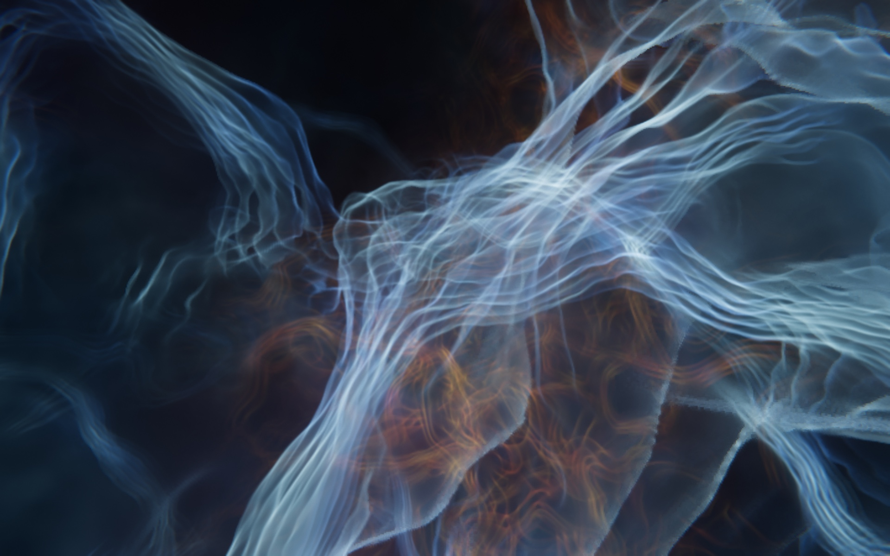

# Nebula

A macOS screensaver that flies endlessly through a glowing supernova remnant.



Each launch starts in empty space, flies out through the ragged edge of the nebula and then drifts through layered blue shock fronts, gold filigree and red hydrogen haze.  Every screen gets its own random route, so no two runs look the same.  It is raymarched on the GPU in Metal with a filmic HDR pipeline, and all of it is procedural - there are no images or videos involved.

## Vibe coded

This project is vibe coded.  All of the code was written by Claude Code.  I steered it with reference images, feedback on how the output looked and power measurements, and made the design calls, but I haven't reviewed the code.  It works on my machine, but treat it accordingly.

## Requirements

macOS 14 or later on Apple silicon.  It is tuned for HiDPI displays.

## Installing

Download the latest `nebula-<version>.zip` from the [Releases](../../releases) page and unzip it.  Double-click `Nebula.saver` and macOS will offer to install it, then choose Nebula in System Settings under Screen Saver.  To update, install a newer release over the top.

## Building from source

Building needs the Xcode command line tools (`xcode-select --install`).

```sh
make install
```

This builds `Nebula.saver` and copies it to `~/Library/Screen Savers`.  `make run` opens a test window instead, which is handy for trying it without waiting for the screensaver to start.

## Licence

MIT, see [LICENSE](LICENSE).
